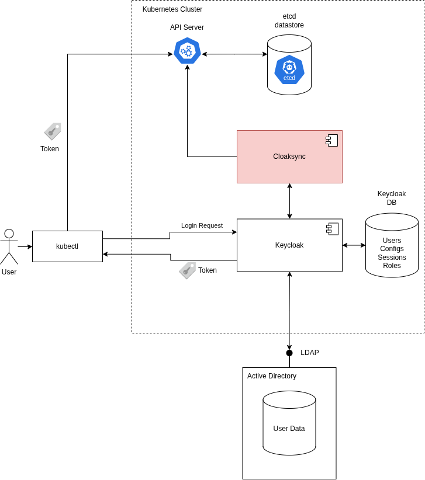
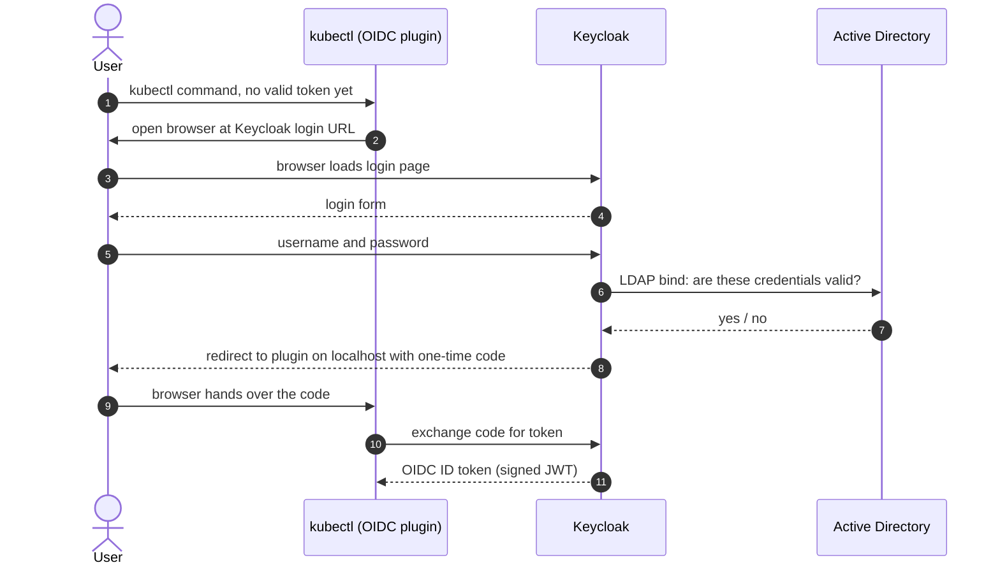
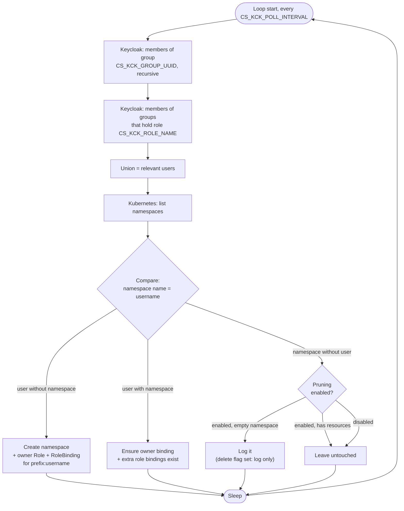

# Overview

Important Note:
> CloakSync needs only Keycloak and Kubernetes. It does not matter where Keycloak gets its users. In our deployment, Keycloak gets them from Active Directory (AD), so these docs use AD as the user source.

## Components and Process

Whenever someone tries to access the cluster through kubectl, they need a token. In order to get a token, users need to authenticate. Keycloak orchestrates the authentication process (the entire OIDC login).

Users are expected to have installed and configured kubectl with the OIDC plugin. Because of this, on first use or whenever a session token has expired, the kubectl OIDC plugin opens the HTTPS login endpoint that Keycloak offers.

In OIDC terms, Keycloak is the OpenID Provider (OP). It exposes the login page, the token endpoint and the userinfo endpoint. Internally (in our project) it relies on active directory to verify user credentials through the LDAP protocoll.

If the credentials are valid, a token is returned, which kubectl attaches to any communication with the API server. The API server checks the token and trusts Keycloak's signature.

## The Problem

Kubernetes does not manage users. It only trusts tokens from an identity provider that the cluster is configured to trust. In our setup, this provider is Keycloak. A user who logs in through Keycloak proves who they are, but that is all. They have no namespace and no permissions in the cluster, so every request fails with "forbidden". An administrator would have to create a namespace, a role and a role binding by hand for each new user.

CloakSync automates this step.

## What CloakSync Does

CloakSync runs as a daemon in the cluster. At a fixed interval, it:

1. reads the members of a Keycloak group and of groups with a given role,
2. creates a namespace for each member, named after the user,
3. creates a role and role binding that give the user access to their own namespace,
4. optionally gives the user extra roles in their namespace,
5. checks existing namespaces, and optionally reports empty namespaces that have no matching user.

A user who is added to the Keycloak group gets a private namespace automatically.

## Sequence: Login

AI content. Not verified yet.

Source: [architecture-seq-login.mmd](./assets/architecture-seq-login.mmd)

## Sync Loop

AI content. Not verified yet.

Source: [architecture-sync-loop.mmd](./assets/architecture-sync-loop.mmd)

